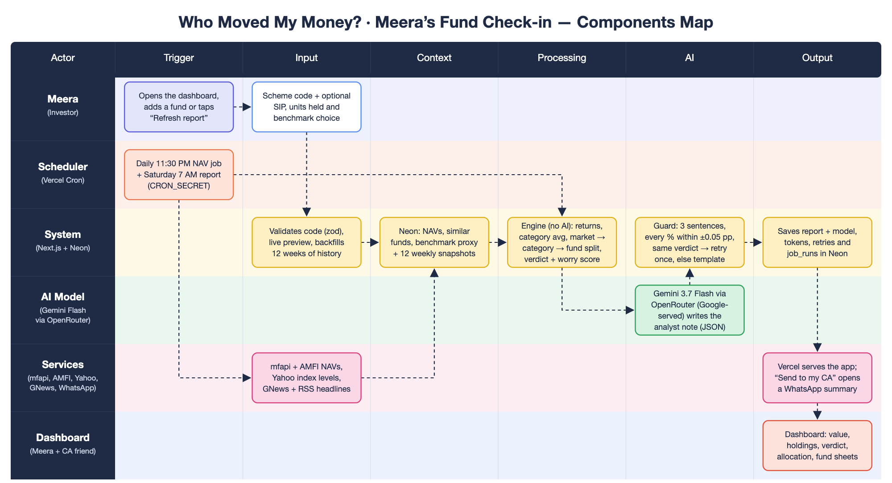
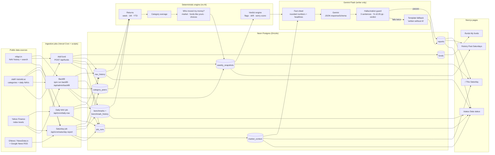
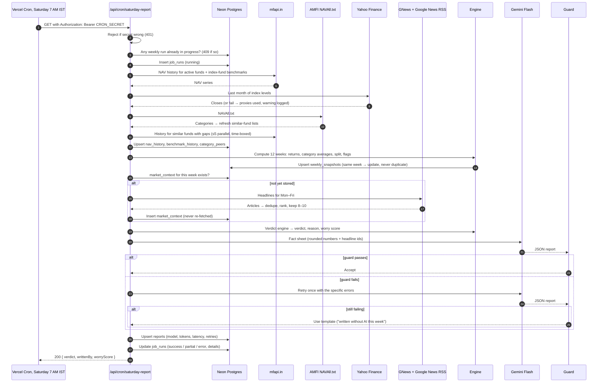

# Components map — Who Moved My Money?

How data flows from public sources to Meera's portfolio dashboard. Live app: https://who-moved-my-money.vercel.app

*Source: [`docs/components-map.svg`](docs/components-map.svg), generated by `node scripts/components-map.mjs`.*

## Reading the map, box by box

| Actor | Stage | Box | What happens | Code |
|---|---|---|---|---|
| **Meera** (investor) | Trigger | Opens the dashboard, adds a fund or taps "Refresh report" | Viewing is open to everyone. Changing funds or regenerating asks for the admin passcode once per device (a small popup, stored as an HMAC in an httpOnly cookie). | `src/app/page.tsx`, `src/components/admin/AdminProvider.tsx` |
| Meera | Input | Scheme code + optional SIP, units held, benchmark | The add-fund form shows a live preview (name, fund house, SEBI category, latest NAV, suggested benchmark) before saving. | `src/components/funds/FundsManager.tsx`, `GET /api/funds/lookup` |
| **Scheduler** (Vercel Cron) | Trigger | Daily 11:30 PM NAV job + Saturday 7 AM report | `vercel.json` crons call `/api/cron/daily-nav` and `/api/cron/saturday-report` with `Authorization: Bearer CRON_SECRET`; wrong or missing secret → 401. One weekly run at a time. | `src/app/api/cron/*`, `src/lib/jobs/scheduled.ts` |
| **Services** | Input | mfapi + AMFI NAVs, Yahoo index levels, GNews + RSS headlines | Every response zod-validated, retried with backoff, ≤5 parallel requests. AMFI's two naming schemes for the same SEBI category are normalised; headlines deduplicated, ranked, weather stories dropped, stored once per week. | `src/lib/sources/*`, `src/lib/classify.ts` |
| **System** (Next.js + Neon) | Input | Validates code, live preview, backfills 12 weeks | `POST /api/funds` validates against live data, saves (or re-activates) the fund, then backfills its full NAV history, its similar funds and 12 weekly snapshots in the same request. | `src/lib/funds/*`, `src/lib/jobs/backfill.ts` |
| System | Context | Neon: NAVs, similar funds, benchmark proxy, 12 weekly snapshots | Nine Postgres tables via Drizzle: `funds`, `nav_history`, `benchmarks`, `benchmark_history`, `category_peers`, `weekly_snapshots`, `market_context`, `reports`, `job_runs`. | `src/db/schema.ts`, `src/db/migrations/` |
| System | Processing | Engine (no AI): returns, category average, market → category → fund split, verdict + worry score | 1W / 1M / YTD from the last NAV on or before each date; equal-weighted category average; the three parts always sum to the fund's return; rule-based flags (persistence, noise band, debt vs similar funds), allocation drift, worry score 0–100. | `src/lib/engine/*`, `src/config/verdict.ts` |
| **AI Model** (Gemini Flash via OpenRouter) | AI | Gemini writes the analyst note from a rounded fact sheet | `google/gemini-3.7-flash` through the OpenRouter gateway, pinned to Google-served endpoints (`provider.only = google-vertex, google-ai-studio`, no fallbacks), strict `json_schema` output; professional analyst voice; told the verdict and forbidden to compute numbers. | `src/lib/gemini/factSheet.ts`, `prompt.ts`, `openrouter.ts`, `writer.ts` |
| System | AI | Guard: 3 sentences, every % within ±0.05 pp, same verdict → retry once, else template | Rejects wrong JSON, wrong sentence count, a changed verdict, any percentage not in that fund's facts, unknown headline ids, advice or weather words. One retry with the errors fed back; then a deterministic template marked "Written without AI this week". | `src/lib/gemini/hallucinationGuard.ts`, `templateFallback.ts` |
| System | Output | Saves report + model, tokens, retries and job_runs | Upserts make every job idempotent (same week → update, never duplicate). Each run's timings, warnings and errors land in `job_runs`, shown on `/status`. | `src/lib/jobs/report.ts`, `src/db/queries.ts` |
| **Services** | Output | Vercel serves the app; "Send to my CA" opens a WhatsApp summary | Hosted on Vercel (Singapore region, next to Neon). The share button builds a `wa.me` link with the verdict, one line per fund and a link to the report. | `src/lib/share.ts`, `src/components/checkin/ShareButtons.tsx` |
| **Dashboard** (Meera + CA friend) | Output | Dashboard: value, holdings, verdict, allocation, fund sheets | Portfolio value and returns, holdings table, portfolio health verdict with worry dial, allocation donut, weekly analyst note, markets card; each fund's full analysis (who-moved-my-money bars, 12-week chart, returns vs benchmark and category, data sources) opens in a side sheet. | `src/app/page.tsx`, `src/components/dashboard/*` |

## Architecture (detailed data flow)

## Components

| Component | File path | Responsibility | Inputs | Outputs | External dependency |
|---|---|---|---|---|---|
| Env validation | `src/lib/env.ts`, `src/instrumentation.ts` | Fail fast on boot with a readable message if required env vars are missing | `process.env` | Typed config | zod |
| DB schema & migrations | `src/db/schema.ts`, `src/db/migrations/` | The 9 tables from the brief (plus peer group, asset class, latency columns) | — | Tables, types | Neon Postgres, Drizzle ORM |
| DB client | `src/db/client.ts` | Neon serverless HTTP connection | `DATABASE_URL` | Drizzle instance | `@neondatabase/serverless` |
| Queries & job log | `src/db/queries.ts` | Chunked upserts, series reads, peer-group replace, `withJobRun` (job_runs rows with timings/warnings/errors) | Rows | Rows, job_runs | Neon |
| HTTP helper | `src/lib/http.ts` | Timeouts, retries with backoff, concurrency limit (≤5) | URL | Response | `fetch` |
| Dates | `src/lib/dates.ts` | Asia/Kolkata dates, Fridays, month/year arithmetic, source date formats | Dates | ISO dates | — |
| mfapi client | `src/lib/sources/mfapi.ts` | Scheme meta + NAV history; search; unknown-code detection | Scheme code / query | `SchemeData` | mfapi.in |
| AMFI client | `src/lib/sources/amfi.ts` | Parse NAVAll.txt; build Direct-Growth peer groups | NAVAll.txt | Schemes, peer groups | AMFI |
| Classifier | `src/lib/classify.ts` | Normalise AMFI's duplicate category names; peer group per fund; asset class; benchmark suggestion; plan/option detection | Category, scheme name | Peer group, benchmark key | — |
| Benchmark catalogue | `src/lib/sources/benchmarkCatalog.ts` | Verified index-fund proxies (TRI approx.) + Yahoo fallbacks + market strip | — | Benchmark definitions | — |
| Yahoo client | `src/lib/sources/yahoo.ts` | Daily index closes (drops today's partial bar) | Symbol | Points | Yahoo Finance |
| News client | `src/lib/sources/news.ts` | Provider interface (GNews / NewsData.io), Google News RSS top-up, dedupe, relevance ranking, weather filter | Date window, keys | 8–10 headlines with ids | GNews, NewsData.io, Google News |
| Fund lookup | `src/lib/funds/lookup.ts` | Live preview for the add form; warnings (IDCW, Regular, stale, missing from AMFI) | Scheme code | `FundPreview` | mfapi, AMFI |
| Fund registry | `src/lib/funds/register.ts` | Add / re-activate / soft-delete funds | Code, benchmark, SIP, units | `funds` row | Neon |
| Ingest | `src/lib/jobs/ingest.ts` | Benchmark sync, peer refresh, fund + peer history, AMFI daily upsert | Active funds | nav_history, benchmark_history, category_peers | mfapi, AMFI, Yahoo |
| Backfill | `src/lib/jobs/backfill.ts`, `scripts/backfill.ts`, `/api/admin/backfill` | Full history + 12 weekly snapshots (+ latest report); resumable | — | Rows | as Ingest |
| Returns | `src/lib/engine/returns.ts` | Week / 1M / YTD from the last NAV on or before each date; YTD-from-launch flag | Series, week | Returns | — |
| Category average | `src/lib/engine/categoryAverage.ts` | Equal-weighted peer mean, excluding self, missing data and implausible values | Peer series | Average + count | — |
| Decomposition | `src/lib/engine/decomposition.ts` | market / funds like yours / your fund's choices; dominant driver | Fund, benchmark, category returns | Parts summing to the fund return | — |
| Verdict engine | `src/lib/engine/verdict.ts`, `src/config/verdict.ts` | Flags (persistence, noise band, debt vs similar funds), allocation drift, portfolio verdict, worry score | Weekly facts, holdings | Verdict, reason, score | — |
| Snapshots | `src/lib/engine/snapshots.ts`, `src/lib/jobs/snapshots.ts` | Per fund per week: returns, split, flags, provenance; idempotent upsert | Stored series | weekly_snapshots | Neon |
| Market context | `src/lib/jobs/marketContext.ts` | Weekly index moves + headlines, fetched once per week | Week | market_context | Yahoo, news |
| Fact sheet | `src/lib/gemini/factSheet.ts` | Compact JSON of rounded numbers for Gemini; allowed-percentage lists | Snapshots, verdict, news | `FactSheet` | — |
| Prompt & schema | `src/lib/gemini/prompt.ts`, `src/lib/gemini/schema.ts` | System instruction; zod + Gemini `responseSchema` | Fact sheet | Prompt, schema | — |
| Hallucination guard | `src/lib/gemini/hallucinationGuard.ts` | JSON shape, 3 sentences, verdict, % within ±0.05 pp per fund, headline ids, advice/weather words | Gemini output, fact sheet | ok / errors | — |
| Template fallback | `src/lib/gemini/templateFallback.ts` | Deterministic report that always passes the guard | Fact sheet | Report | — |
| OpenRouter client | `src/lib/gemini/openrouter.ts` | `google/` models only, Google-served endpoints only, strict JSON schema, low reasoning effort; retries 429/5xx ×3, stops on 402; model-exists check | Prompt, schema | Text, tokens, cost | OpenRouter → Gemini |
| Writer | `src/lib/gemini/writer.ts` | Gemini call → guard → one retry with errors → template; tokens, latency, retries, cost | Fact sheet | `WrittenReport` | Gemini via OpenRouter |
| Report job | `src/lib/jobs/report.ts`, `scripts/report.ts` | Load snapshots, verdict, context, write, upsert `reports` | Week | reports | Neon, Gemini |
| Scheduled jobs | `src/lib/jobs/scheduled.ts`, `src/lib/jobs/runners.ts` | Daily NAV; Saturday report; one weekly run at a time | — | JSON result, job_runs | all sources |
| Cron routes | `src/app/api/cron/*/route.ts`, `vercel.json` | `CRON_SECRET`-protected entry points, `maxDuration` | Vercel Cron | JSON | Vercel |
| Admin & funds API | `src/app/api/admin/*`, `src/app/api/funds/*`, `src/lib/auth/passcode.ts`, `src/lib/api.ts` | Passcode session (HMAC cookie), run-now, backfill, add/remove/patch funds, rate-limited lookup | HTTP | JSON | — |
| Status API | `src/app/api/status/check/route.ts` | Live health check of Neon, mfapi, AMFI, Yahoo, news, Gemini | HTTP | Check list | all sources |
| Page data | `src/lib/data/views.ts` | Server-side view models for the four pages | Neon | Views | Neon |
| App shell | `src/app/layout.tsx`, `src/components/shell/SideRail.tsx`, `TopBar.tsx`, `Ticker.tsx`, `src/lib/data/ticker.ts` | Left icon rail / phone tab bar, pill search (→ Funds scheme search), index ticker (last two stored Yahoo closes) | `benchmark_history` | HTML | — |
| Dashboard page | `src/app/page.tsx`, `src/components/dashboard/Cards.tsx`, `HoldingsTable.tsx`, `AmountToggle.tsx` | Navy portfolio card + 12-week value chart (eye hides amounts), sortable/filterable holdings table, portfolio health (verdict chip, worry dial), allocation donut, weekly analyst note, markets card | Dashboard view | HTML | — |
| Fund analysis sheet | `src/components/dashboard/Sheet.tsx`, `FundDetail.tsx` | Side sheet per fund: holding stats, analyst note, who-moved-my-money bars, 12-week chart, returns vs benchmark and category, data sources | Fund card | Dialog | — |
| Shared visuals | `src/components/checkin/Pct.tsx`, `Waterfall.tsx`, `Sparkline.tsx`, `WorryDial.tsx` | ▲/▼ percentages (never colour alone), the three-part waterfall, sparkline, worry dial | Numbers | SVG/HTML | — |
| Motion | `src/lib/gsap.ts`, `src/components/dashboard/DashboardMotion.tsx` | One load timeline (accent, value count-up, value line + donut draw, dial sweep, rows); sheet bars fill on open; reduced motion shows final states | DOM | Animation | GSAP (SplitText, DrawSVG, ScrollTrigger) |
| Admin popup | `src/components/admin/AdminProvider.tsx`, `GenerateNow.tsx` | No passcode box on pages; on a 401 a small dialog asks for the passcode once, then retries the action | Fetch | Retried request | — |
| Sample holdings | `src/lib/funds/sipSimulation.ts`, `scripts/sample-holdings.ts` | Replays each fund's monthly SIP since Jan 2024 at real NAVs → units + invested (marked sample, editable) | NAV history, SIP | `funds.units_held`, `invested_amount` | Neon |
| Share | `src/lib/share.ts`, `src/components/checkin/ShareButtons.tsx` | WhatsApp text + copy summary | Check-in view | `wa.me` link | WhatsApp |
| Funds page | `src/app/funds/page.tsx`, `src/components/funds/FundsManager.tsx` | List with Edit (SIP, units, invested) and Remove, add with live preview, scheme search | Funds view | API calls | — |
| History page | `src/app/history/page.tsx` | Past reports; 12-week "beating similar funds" strips | History view | HTML | — |
| Status page | `src/app/status/page.tsx`, `src/components/status/SourceCheck.tsx` | Freshness, benchmarks used, job runs, Gemini usage, live check | Status view | HTML | — |
| Glossary | `src/lib/glossary.ts`, `src/components/glossary/Glossary.tsx` | Dotted-underlined terms → one-sentence drawer | Text, `jargonUsed` | Drawer | — |
| Design tokens | `src/styles/tokens.css`, `src/app/globals.css` | Colours (verdict states, dark theme), type, spacing | — | CSS | Google Fonts (via `next/font`) |
| Source verification | `scripts/verify-sources.ts` | Live check of every source; non-zero exit on failure | Network | Report | all sources |
| Seed | `scripts/seed.ts`, `scripts/seedFunds.ts` | Meera's five verified funds | — | funds | mfapi, AMFI |

## The Saturday job, step by step

