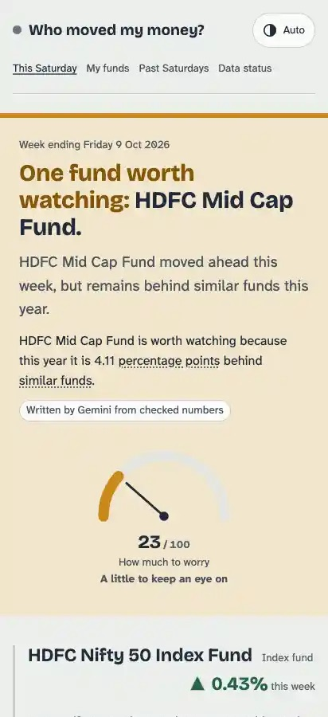
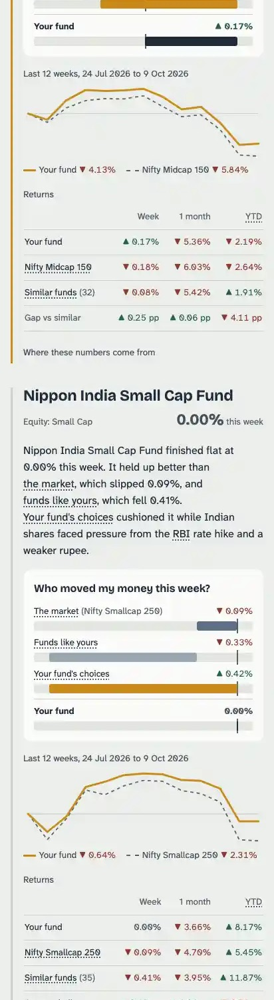
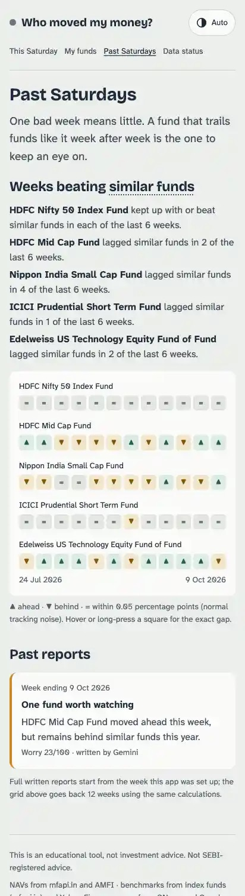
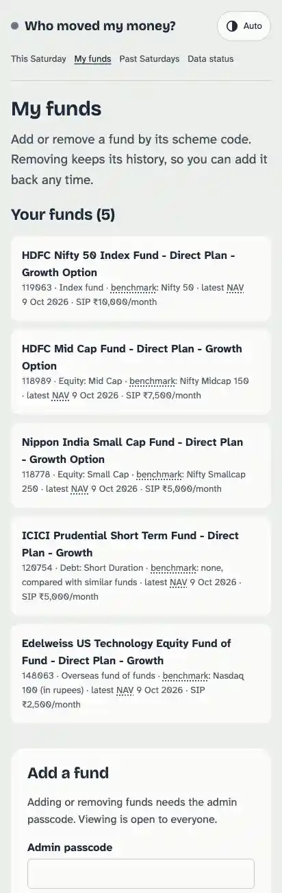
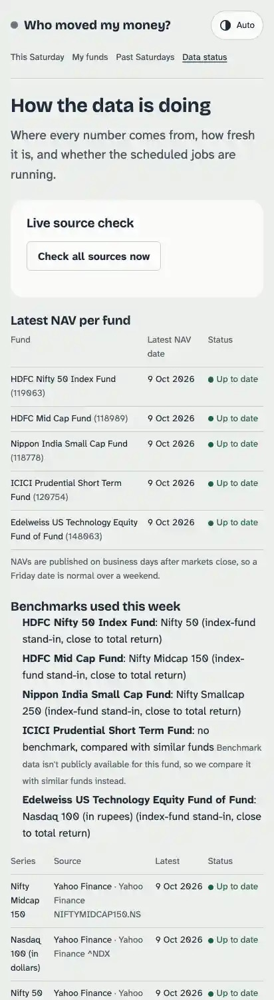

# Who Moved My Money?

**Meera's Saturday mutual fund check-in.** Every Saturday morning it answers one question in plain language:

> *My fund went down — was that the whole market, funds like mine, or my fund itself?*

**Live app:** https://who-moved-my-money.vercel.app · **Architecture:** [COMPONENTS_MAP.md](COMPONENTS_MAP.md)

MESA Cohort C4 · *AI and its Applications* · final project.

| This Saturday | Who moved my money? | Past Saturdays |
|---|---|---|
|  |  |  |

| My funds | Data status |
|---|---|
|  |  |

---

## The problem

Meera has five mutual funds: a large-cap index fund, a mid-cap fund, a small-cap fund, a short-duration debt fund and an international fund of funds. Every weekend she checks their NAVs, sees a red number, and wonders whether to worry. Today she screenshots the NAVs and sends them to a CA friend on WhatsApp.

What she actually needs to know is **whether a fall is a broad market event or something specific to her fund** — and whether it keeps happening.

**Meera's portfolio (seed data).** Every code was found with mfapi search and checked for live NAVs, not taken from memory ([`scripts/seedFunds.ts`](scripts/seedFunds.ts)):

| Role | Fund (Direct Plan – Growth) | Code | Compared with |
|---|---|---|---|
| Large-cap index | HDFC Nifty 50 Index Fund | 119063 | Nifty 50 · 23 Nifty 50 index funds |
| Mid-cap | HDFC Mid Cap Fund | 118989 | Nifty Midcap 150 · 32 mid-cap funds |
| Small-cap | Nippon India Small Cap Fund | 118778 | Nifty Smallcap 250 · 35 small-cap funds |
| Short-duration debt | ICICI Prudential Short Term Fund | 120754 | no public benchmark · 22 short-duration funds |
| International FoF | Edelweiss US Technology Equity Fund of Fund | 148063 | Nasdaq 100 (in rupees) · 9 US-equity FoFs |

The mid- and small-cap funds are actively managed on purpose: if they were index funds, "your fund's choices" would always be about zero. (HSBC Short Duration Fund was the first debt pick, but source verification showed its last NAV was in November 2022 — the scheme was merged — so it was replaced.)

## The idea: "Who moved my money?"

Each week, every fund's return is split into three parts that **add up exactly** to the fund's return:

| Part | Meaning | Formula |
|---|---|---|
| **The market** | The whole slice of the market the fund invests in moved | `benchmark return` |
| **Funds like yours** | All similar funds moved beyond the market | `category average − benchmark` |
| **Your fund's choices** | The fund manager's own decisions | `fund return − category average` |

The part with the largest size is the **dominant driver**, and that is what the weekly summary explains. If a fund has no public benchmark (like a short-duration debt fund), the split honestly collapses to two parts and the page says so.

Worked example (from the unit tests): fund −1.80%, market −1.50%, mid-caps −1.60% → *the market* −1.50%, *funds like yours* −0.10%, *your fund's choices* −0.20%. Most of the fall was the whole market.

The portfolio verdict is always one of three exact phrases, each with its own calm colour:

- **No action needed** (green)
- **One fund worth watching** (amber)
- **Consider reviewing your allocation** (plum)

A **"How much to worry" score (0–100)** sits beside it as a quiet dial, not an alarm.

## How it works

1. **Data in (live, no hardcoded numbers).** NAVs from mfapi.in and AMFI; benchmarks from index funds (and Yahoo Finance as fallback); the week's market headlines from GNews with Google News RSS.
2. **Deterministic engine.** Returns, similar-fund averages, the three-way split, flags and the verdict are pure TypeScript with unit tests. **Gemini never computes a number.**
3. **Gemini writes, the guard checks.** Gemini Flash gets a compact "fact sheet" of rounded numbers and the week's headlines and writes the plain-language report. A hallucination guard rejects anything that breaks the rules (below); one retry with the errors fed back; then a deterministic template takes over and the page says *"Written without AI this week"*.
4. **Scheduled on Vercel.** A daily NAV update and the Saturday report run as Vercel Cron jobs. A "Generate this week's report now" button (passcode-protected) exists for demos.

See [COMPONENTS_MAP.md](COMPONENTS_MAP.md) for the architecture diagram, every component, and the Saturday sequence diagram.

## The verdict rules, in plain English

All thresholds live in [`src/config/verdict.ts`](src/config/verdict.ts) with comments. Returns are simple returns; "pp" means percentage points.

**An equity fund (or hybrid / other) is "worth watching" if either:**
- Its own choices cost it money against similar funds in **at least 3 of the last 4 weeks**, **and** it is more than **1.5 pp behind** similar funds over the last month. Both must be true — **one bad week alone never flags a fund**. Weekly differences smaller than **0.05 pp** count as tracking noise (an index fund trails its index by its fee every week; that is not underperformance).
- Year to date it is more than **4 pp behind** similar funds. (Not applied to a fund launched this year, whose YTD is "since launch".)

**A debt fund is "worth watching" if either:**
- It falls more than **0.3% in a single week** *and* does more than **0.2 pp worse than similar debt funds** that week — a possible credit event (a bond it holds being downgraded).
- Its **1-month return is negative** *and* it is more than **0.25 pp behind similar debt funds** over that month.

*Why debt compares with similar funds:* when the RBI raises rates, every bond fund dips together. That is the market, not the fund — exactly what this app exists to tell apart. (During development, a week with an RBI rate hike pushed every short-duration fund slightly negative; flagging Meera's fund for that would have contradicted the app's own idea. This change was agreed before building.) If similar-fund data is ever missing, the plain −0.3% / negative-month rules apply on their own, so nothing goes unchecked.

**Portfolio verdict**
- 0 funds flagged → **No action needed**
- 1 fund flagged → **One fund worth watching**
- 2 or more flagged, **or** allocation drift → **Consider reviewing your allocation**

**Allocation drift (optional).** If you enter *monthly SIP* and *units held* for **every** fund, the app compares each fund's share of your money today (units × NAV) with the share your SIPs aim for. More than **10 pp** apart on any fund triggers a review. If any number is missing, this rule is skipped and the page doesn't pretend otherwise.

**How much to worry (0–100)** = flagged funds (up to 50) + how persistently equity funds lag (up to 25) + how far funds trail similar funds over a month (up to 10) + allocation drift (up to 15).

## Gemini — the plain-language writer

- **Model:** `GEMINI_MODEL`, default **`gemini-3.8-flash`** (the current stable Flash model on Google's model list when this was built), via the official `@google/genai` SDK with `responseMimeType: "application/json"` and a `responseSchema`. Low "thinking" level: writing from a fixed fact sheet needs little reasoning, and it keeps a report to about 6–12 seconds.
- **Input:** a fact sheet of rounded numbers (2 decimals) per fund — this week, 1 month, YTD for the fund, the market and similar funds; the gaps; the three-way split and its biggest part; flags with reasons; the index moves; and the week's headlines with ids. The verdict is **given**; Gemini explains it and may not change it.
- **Style rules (system instruction):** written for a smart 28-year-old who doesn't read factsheets; short sentences; finance terms explained; the market / funds like yours / your fund's choices framing; **no weather or nature words**; never "buy", "sell", "redeem" or "switch" — "keep an eye on" or "talk to your advisor" instead.

**Hallucination guard** ([`src/lib/gemini/hallucinationGuard.ts`](src/lib/gemini/hallucinationGuard.ts)) — the report is rejected unless:
1. It matches the JSON schema (zod).
2. Every fund summary is **exactly 3 sentences** (decimals and abbreviations don't count as sentence ends).
3. `verdict` equals the engine's verdict, word for word.
4. **Every percentage** in the prose is within **±0.05 pp** of a fact-sheet number — and a fund's summary may only use *that fund's* numbers (plus market moves and the verdict facts), so it can't borrow a near-miss number from another fund.
5. Every cited headline id exists; no advice words; no weather words; no double negatives like "fell -0.18%".

On failure: one retry with the specific errors fed back → otherwise the deterministic template report, marked **"Written without AI this week"**. Model, token counts, latency and retry count are stored with every report and shown on `/status`.

## "Send to my CA"

Every report has a **Send to my CA** button that opens WhatsApp (`https://wa.me/?text=…`) with a clean summary — the verdict, one line per fund (this week vs the market and similar funds) and a link to the full report — plus a **Copy summary** button. This replaces Meera's habit of screenshotting NAVs to her CA friend.

## Data sources and their limits

Every source was verified with a live call before building on it ([`scripts/verify-sources.ts`](scripts/verify-sources.ts), `npm run verify`).

| Source | Used for | Notes and limits |
|---|---|---|
| **mfapi.in** `/mf/{code}`, `/mf/search` | Full NAV history; scheme search for the add-fund form | Free, no key. Unknown codes return HTTP 200 with empty data — handled as "not found". Retries with backoff, ≤5 requests in parallel. |
| **AMFI NAVAll.txt** | Official SEBI category of every scheme; the similar-funds lists; one-download daily NAV update | Now served from `portal.amfiindia.com`. AMFI publishes the **same category under two naming schemes** (e.g. "Debt Scheme - Short Duration Fund" and "Income/Debt Oriented Schemes - Short Term Fund"; "Equity Scheme" vs "Equity Schemes"). These are normalised, otherwise half the peers would silently drop out. Similar funds = **Direct Plan – Growth only**, no IDCW/bonus/segregated variants, still publishing NAVs. |
| **Index funds as benchmarks** (via mfapi) | Primary benchmark: UTI Nifty 50 (120716), Motilal Oswal Nifty 500 (147625), Midcap 150 (147622), Smallcap 250 (147623), ICICI Pru Nasdaq 100 (149219), Motilal Oswal S&P 500 (148381) | **Total Return Index approximation:** growth-option index funds reinvest dividends, so they track the TRI (the fair yardstick) minus a small fee and tracking error. The Nifty 50 proxy is a *different* fund from Meera's own index fund, so her fund's small tracking difference still shows. |
| **Yahoo Finance chart API** | Fallback benchmark; the Saturday market strip (`^NSEI`, `NIFTYMIDCAP150.NS`, `NIFTYSMLCAP250.NS`) | Price index only (no dividends). **Nifty Smallcap 100 has no working Yahoo symbol**, so the strip shows Smallcap 250. US indices (`^NDX`, `^GSPC`) are in dollars, so rupee moves aren't included — the page says so when this fallback is used. If Yahoo blocks or rate-limits, the index-fund proxies are used and the provenance records it. |
| **Debt fund benchmark** | — | CRISIL debt indices aren't publicly available, so the debt fund is compared with similar funds only, and the page says so. |
| **Overseas FoF benchmark** | Nasdaq 100 (in rupees) | Meera's Edelweiss US Technology FoF is compared with a Nasdaq 100 index fund — an approximation, since the FoF holds a tech-tilted basket rather than exactly the Nasdaq 100. |
| **GNews** (`GNEWS_API_KEY`) / **NewsData.io** (`NEWSDATA_API_KEY`) | The week's market headlines | Either key works (provider interface). The free NewsData.io endpoint only reaches back ~48 hours, so whenever a provider returns fewer than 8 usable headlines, **Google News RSS** tops up. Headlines are deduplicated by URL and title similarity, ranked for market relevance (Nifty, Sensex, RBI, FII, inflation, rupee…), 8–10 kept, and **stored once per week and never re-fetched**. Weather-driven headlines are dropped on purpose. NewsAPI.org is not used (its free tier is development-only and delayed). |
| **Gemini** | Writing the report | See above. |

All dates and schedules are in **Asia/Kolkata**. "This week" is the last NAV on or before Friday vs the last NAV on or before the previous Friday; holidays (e.g. Gandhi Jayanti on 2 Oct) fall back to the previous NAV automatically.

## Setup

Requirements: Node 20+ (built on Node 24), a free [Neon](https://neon.tech) Postgres database, a [Gemini API key](https://aistudio.google.com), optionally a [GNews](https://gnews.io) key.

```bash
git clone https://github.com/manavmehta2001/who-moved-my-money.git
cd who-moved-my-money
npm install
cp .env.example .env.local      # then fill in the values below
npm run verify                  # checks every external source; exits non-zero if a required one fails
npm run db:migrate              # creates the 9 tables in Neon (migrations are in src/db/migrations)
npm run seed                    # Meera's five funds
npm run backfill                # full history + 12 weekly snapshots + this week's Gemini report
npm run dev                     # http://localhost:3000
```

### Environment variables

| Variable | Required | What it is |
|---|---|---|
| `DATABASE_URL` | yes | Neon **pooled** connection string |
| `GEMINI_API_KEY` | yes | Google AI Studio key |
| `GEMINI_MODEL` | no | Defaults to `gemini-3.8-flash` |
| `GNEWS_API_KEY` / `NEWSDATA_API_KEY` | no | One is enough; with neither, Google News RSS is used |
| `CRON_SECRET` | yes | Long random string; Vercel sends it as `Authorization: Bearer …` to the cron routes |
| `ADMIN_PASSCODE` | yes | Unlocks adding/removing funds and "Generate now" in the UI |
| `NEXT_PUBLIC_APP_URL` | no | Public URL, used in the WhatsApp share link |

The server refuses to start with a readable error if a required variable is missing ([`src/lib/env.ts`](src/lib/env.ts), validated with zod). Secrets live only in `.env.local` (git-ignored) and in Vercel's encrypted environment variables.

### Backfill

`npm run backfill` (or `POST /api/admin/backfill` with the passcode cookie or `Authorization: Bearer $CRON_SECRET`) pulls full NAV history for the active funds and the benchmark index funds, refreshes the similar-funds lists from AMFI, fetches similar funds' history from the start of the window the maths needs, computes **the last 12 weekly snapshots** so trend charts work on day one, and writes a full Gemini report **for the most recent week only**. It is safe to re-run: every write is an upsert and similar funds that already have the history are skipped. The HTTP route stops before its time limit and answers `{ "done": false }` so it can simply be called again. **Adding a fund through the form backfills that fund automatically.**

### Cron (Vercel)

Defined in [`vercel.json`](vercel.json) (UTC; Vercel Hobby runs each job once a day and may start it anywhere within the hour):

| Job | Schedule | What it does |
|---|---|---|
| `/api/cron/daily-nav` | `0 18 * * *` (≈ 11:30 PM IST) | One AMFI download → latest NAV for Meera's funds, every similar fund and the benchmark index funds; refreshes a month of Yahoo index levels |
| `/api/cron/saturday-report` | `30 1 * * 6` (≈ 7:00 AM IST Saturday) | Refresh similar-fund lists, repair any NAV gaps, recompute 12 weeks of snapshots, fetch the week's news (once), run the verdict engine, ask Gemini, save the report |

Both reject requests without `CRON_SECRET` (401), are **idempotent** (running the same week twice updates rows, never duplicates — verified: snapshots 60 → 60, reports 1 → 1, market context 1 → 1), only allow one weekly run at a time, set `maxDuration`, and write a `job_runs` row with timings, warnings and errors (visible on `/status`). Functions run in Vercel's Singapore region, next to the Neon database.

### Other endpoints

- `POST /api/admin/run-report` — "Generate this week's report now" (passcode or cron secret).
- `GET /api/funds/lookup?code=` — live preview for the add form (rate-limited); `?q=` searches scheme names.
- `POST /api/funds`, `DELETE /api/funds/[code]` (soft delete), `PATCH /api/funds/[code]` (change benchmark / SIP / units).
- `POST /api/admin/session` — enter the passcode once; stored as an HMAC in an httpOnly cookie (the passcode itself is never stored).
- `GET /api/status/check` — live health check of every source (rate-limited).

## Pages

- **`/` This Saturday** — the verdict as a sentence, the worry dial, the week's headline; one section per fund with its 3-sentence summary, the "Who moved my money?" waterfall, a 12-week sparkline (fund vs benchmark) and a returns table (week / 1 month / YTD for the fund, the benchmark and similar funds); the market strip and the cited headlines; *Send to my CA*. `/?week=YYYY-MM-DD` opens a past report.
- **`/funds` My funds** — list with remove buttons; add a fund by scheme code with a live preview (name, fund house, category, suggested benchmark, latest NAV and date), optional SIP and units, clear errors (invalid code, not found, IDCW / Regular-plan warnings, already added); *Find a scheme code* search.
- **`/history` Past Saturdays** — every past report, and a 12-week "weeks beating similar funds" strip per fund ("lagged 4 of the last 6 weeks").
- **`/status` Data status** — latest NAV per fund, every benchmark series and its source, which benchmark each fund used this week, news provider, Gemini model and usage, recent job runs, and a live **Check all sources now** button.
- **Glossary drawer** — any dotted-underlined term (NAV, benchmark, YTD, similar funds, repo rate…, plus terms Gemini lists in `jargonUsed`) opens a one-sentence plain explanation. Words inside fund names are never underlined.

## Design

- **Concept:** a calm Saturday note from a friend who understands money. The accent colour reflects the verdict; nothing is alarming. **No weather or nature imagery anywhere** — UI, icons, copy, animations, and Gemini's prose (enforced by the guard).
- **Tokens:** every colour, size and timing is in [`src/styles/tokens.css`](src/styles/tokens.css). Text colours checked against WCAG AA in light and dark themes (dark theme follows the system and has a toggle).
- **Type:** Bricolage Grotesque for display, Atkinson Hyperlegible (Next) for body — designed by the Braille Institute for legibility. Numbers use tabular figures.
- **Motion (GSAP):** one orchestrated load timeline — the accent eases from neutral to the verdict colour, the verdict settles in word by word (SplitText), the dial needle sweeps, then the waterfall bars fill in order market → funds like yours → your fund's choices. Sparklines draw once on scroll (DrawSVG + ScrollTrigger). Numbers count up only on first view. Adding a fund slides the new row in; removing collapses it; the glossary slides open. **`prefers-reduced-motion` shows final states instantly** (verified in Chrome with `--force-prefers-reduced-motion`).
- **Accessibility:** gains and losses never rely on colour alone (▲/▼ arrows plus "up"/"down" for screen readers); labelled inputs; visible focus; skip link. **Lighthouse (mobile, production): Accessibility 100, Best Practices 100, SEO 100 on all four pages.** Performance 79–93; the check-in page's score is held back mainly by the deliberate load animation and GSAP's JavaScript on Lighthouse's throttled mobile profile.
- **Every number has provenance:** hover a number for its "as of" date and source; each fund has a "Where these numbers come from" section.

## Tests and checks

```bash
npm test             # 73 Vitest tests: returns maths, holidays, leap years, YTD-from-launch, category averages,
                     # "the three parts always sum to the fund's return" (1,000 random cases), verdict rules,
                     # drift, worry score, AMFI / mfapi / RSS parsers, the hallucination guard, retry + fallback
npm run typecheck
npm run lint
npm run verify       # live check of every external source
npm run report       # (re)generate this week's report from the command line
npm run e2e -- https://who-moved-my-money.vercel.app
                     # end-to-end against a live deployment (44 checks): auth on every protected route, pages,
                     # lookup errors, add a fund → backfilled → in the report → re-run the Saturday job (no
                     # duplicates) → remove → out of the report with history kept, the stored report re-checked by
                     # the hallucination guard, the split summing exactly in every snapshot, all sources healthy.
                     # Leaves the portfolio as it found it.
```

## Acceptance checklist

- [x] Production URL shows a real report with this week's real NAVs and real headlines.
- [x] Adding a valid scheme code through the form shows it in the next report with backfilled history; removing it hides it without deleting history *(tested with Parag Parikh Flexi Cap 122639: 12 weeks backfilled → in the report → removed → out of the report, 12 snapshots kept, `is_active = false`)*.
- [x] Invalid code shows a clear error (letters, unknown code, IDCW / Regular warnings, already added).
- [x] Each fund summary is exactly 3 sentences and every % in it matches the data (enforced by the guard on every report).
- [x] Verdict is one of the three exact phrases with a specific reason.
- [x] Decomposition parts sum to the fund's return (unit test, 1,000 random cases).
- [x] Re-running the Saturday job for the same week doesn't duplicate anything.
- [x] Cron routes reject requests without `CRON_SECRET` (401 in production).
- [x] No Anthropic/Claude API calls anywhere (`grep -rniE "anthropic|claude" src scripts` is empty; no `@anthropic-ai` packages).
- [x] Reduced-motion mode works; Lighthouse accessibility ≥ 90 on mobile (100 on every page).
- [x] `/status` shows all sources healthy (7 of 7 in the live check).

## Repository layout

```
src/
  app/                 pages (/, /funds, /history, /status) and API routes (cron, admin, funds, status)
  components/          check-in visuals, glossary, funds manager, admin, status
  config/verdict.ts    every verdict threshold, commented
  db/                  Drizzle schema, migrations, queries
  lib/sources/         mfapi, AMFI, Yahoo, news clients (zod-validated, retries)
  lib/engine/          returns, category average, decomposition, verdict, snapshots
  lib/gemini/          fact sheet, prompt, schema, hallucination guard, template fallback, writer
  lib/jobs/            ingest, backfill, snapshots, market context, report, scheduled jobs
  styles/tokens.css    design tokens
scripts/               verify-sources, seed (Meera's verified funds), backfill, report
```

---

*This is an educational tool, not investment advice. Not SEBI-registered advice.*
